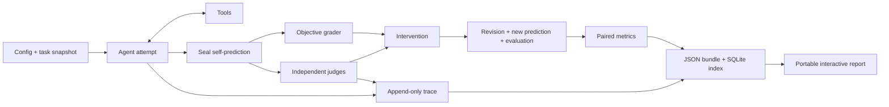

# RAEL: agent evaluation and behavioral research

## Purpose and first slice

RAEL makes the relationship between observable agent behavior, objective task
success, judge perception, and the agent's own predictions inspectable. It is a
local research instrument, independent of competitions and model vendors.

The first complete slice is `predict-your-judge`: 12 small synthetic tasks,
optional calculator/search tools, one baseline attempt, a sealed prediction,
independent evaluator results, optional feedback or self-critique, one revision,
and paired metrics. An offline scripted provider exercises the real harness; it
is explicitly labeled as a fixture, never evidence about model performance.
A live OpenAI-compatible Chat Completions adapter uses environment credentials.

## Repository reconnaissance

The target directory was empty on 2026-09-29, with no Git repository or nested
repositories. Related work exists outside this directory: Brie has
`evaluation/judge_multi_provider.py` and judged JSONL exports; the military
simulation benchmark has domain-specific scoring; Oyente has blind model
comparisons. These are potential adapter sources, not dependencies. RAEL is the
canonical home for this new competition-neutral harness. Existing projects and
their unique research outputs are left in place. Future consolidation should
first map their schemas, then implement import adapters, validate equivalent
results, and only then consider sharing provider implementations.

## Choices

1. **Selected: Python package, JSON/JSONL plus SQLite, self-contained HTML.**
   Three runtime dependencies (Pydantic, PyYAML, HTTPX), no server required for
   reports, no Node build or separate UI data model. This is the smallest complete
   slice with strong validation and portable artifacts.
2. Python API plus React application: useful for live streaming later, but adds
   two runtimes and deployment concerns before the data contract is proven.
3. Existing agent orchestration framework: saves integration code, but obscures
   control over leakage, retries, prompt provenance, and trace semantics.

Python >=3.11. Public package `agentlab`; CLI `agentlab`. No private reasoning
capture, arbitrary Python execution, hidden state, or network tools by default.

## Components

| Boundary | Responsibility |
| --- | --- |
| `core/models.py` | Validated task, public task, trace, prediction, verdict, attempt, experiment schemas |
| `core/protocols.py` | Provider, agent, tool, evaluator, intervention and task adapter contracts |
| `core/agents.py` | Bounded observable tool loop and separate prediction call |
| `core/evaluators.py` | Objective grader, binary/scalar criteria, rubric and pairwise judges, pending human annotation |
| `core/experiments.py` | Sequential stage orchestration, independent views, failure preservation |
| `core/metrics.py` | Pure aggregation with explicit denominators and missingness |
| `core/tools.py` | Safe arithmetic, fixed evidence search, tool registry; no eval or shell execution |
| `providers/` | Scripted fixture and OpenAI-compatible HTTP boundary |
| `adapters/` | JSON task import and future MCP transport protocol |
| `storage/` | Atomic snapshots, append-only trace files, SQLite lookup index |
| `apps/explorer/` | Packaged HTML/CSS/JS reading the exact result bundle |

## Integrity boundaries

The agent receives a `PublicTask` with prompt, context, references, expected
output type, environment, tool allowlist, and tags. Ground truth, deterministic
grading configuration and private metadata are excluded by construction.
The agent receives public judge criteria, but never baseline verdicts before its
prediction is durably recorded. Prediction is a new structured-output call over
the observable attempt transcript. It predicts mean judge score and probability
that a strict majority of the configured scoring panel passes. Confidence in
objective correctness is a separate probability.

Each judge receives its own fresh conversation: public task, answer, tool
evidence, and only its own rubric. It never sees the agent's prediction, another
judge's verdict, or the objective answer key. Objective grading is recorded in a
separate field and never counted as a panel judge. Missing/pending/error verdicts
are not zero scores: aggregates include coverage, and calibration against panel
majority is defined only for a complete scoring panel.

Baseline and revision are distinct immutable attempt records linked by parent
ID. An intervention is a stored object with kind, version, input provenance and
actual feedback text. Evaluator feedback deliberately crosses the boundary only
after baseline completion; self-critique receives no judge results. This is a
paired demonstration, not a causal claim about intervention efficacy. A proper
study needs randomized controls and larger task sets.

## Tracing and failures

Every event has schema version, sequence, UTC time, run ID, phase, type, and JSON
payload. Store exact observable prompts, responses, tool calls/results, exposed
usage, model version/fingerprint, errors, retries, evaluator calls and
interventions. Never request or persist private reasoning fields. HTTP headers
and credentials are never artifacts; error messages must not echo secrets.

Model retries are explicit bounded attempts with separate events. Failed
requests never disappear behind successful retries. Malformed structured outputs
are preserved, fail the stage, and are not silently repaired. Provider failures
produce inspectable incomplete attempts; later tasks may proceed. An interrupted
experiment remains `running` on disk with its partial trace, not a false success.

## Reproduction and persistence

Each unique experiment directory contains resolved `config.json`, a task
snapshot, `manifest.json` with hashes and runtime/package/source provenance,
`traces/<run-id>.jsonl`, individual `runs/<run-id>.json`, `result.json`, and
`report.html`. SQLite indexes IDs and relative artifact paths; JSON is the
portable source of truth and can be read without the database. Writes use
temporary files plus atomic rename. Each completed attempt checkpoints the
bundle. Credentials are read only at the HTTP boundary.

Seeds, temperature, model names and returned versions are retained. Offline
fixtures are deterministic; remote calls are reproducible as recorded inputs,
not guaranteed bit-for-bit repeats. Unconfigured prices or absent usage produce
unknown costs/tokens, not fabricated zeros. Configured token rates yield estimates
with recorded provenance, not invoices.

## Metrics

Per stage: objective success over objectively graded answers (plus eligible and
failed counts), judge pass fraction, complete-panel majority pass rate, mean
score, pairwise binary disagreement, score spread, score MAE, panel Brier score,
objective-confidence Brier score, false confidence/pessimism at stated thresholds,
tool error rate, total latency, reported tokens and estimated cost coverage.
Per complete pair: objective improvement/regression, mean judge score delta,
calibration delta. Denominators and missing values accompany aggregates.
Performance per dollar is undefined when total cost is unknown or zero.

## Explorer design

Three coordinated views: a task-by-evaluator matrix, predicted/observed confidence
plot, and a selected task's before/after answer and expandable trace. The matrix
is the primary navigation and makes individual disagreement visible. No computed
results are invented in the browser; it renders stored metrics and verdicts.

Visual tokens: paper `#edf1f5`, ink `#16273b`, signal blue `#224bd3`, evidence teal
`#14685c`, failure magenta `#a32a55`, quiet slate `#66768b`. System sans text and
STIX/Georgia numerical/display accents (local font search inspected; no unverified
font redistribution). A pale plotting field and a deep-blue trace rail reference
measurement instruments. Dense left-aligned data, connected before/after marks,
small legends and persistent task selection replace oversized KPI tiles.
Keyboard navigation, visible focus, text labels alongside color, responsive
stacking, and accessible detail controls are required. The UI works from a file
URL and contains no CDN dependencies.

## Extensions and explicit limits

New providers implement `Provider.complete`; new agents implement `Agent`;
evaluators implement `Evaluator.evaluate` and return validated verdicts; metrics
are pure functions over attempt records. JSON task adapters keep competition
schemas outside core. MCP gets a transport/tool protocol stub, not a claim of a
working MCP client. Pairwise evaluation is available as a separate comparison
primitive, not silently mixed into single-answer calibration. Human annotation
is pending until a future annotation workflow supplies a verdict.

Full MCP, coding/filesystem sandboxes, streaming, multimodal payloads, model
hosting, concurrent scheduling, causal experimental designs, persistent human
annotation UI, and failure clustering are planned, not part of this pass.
